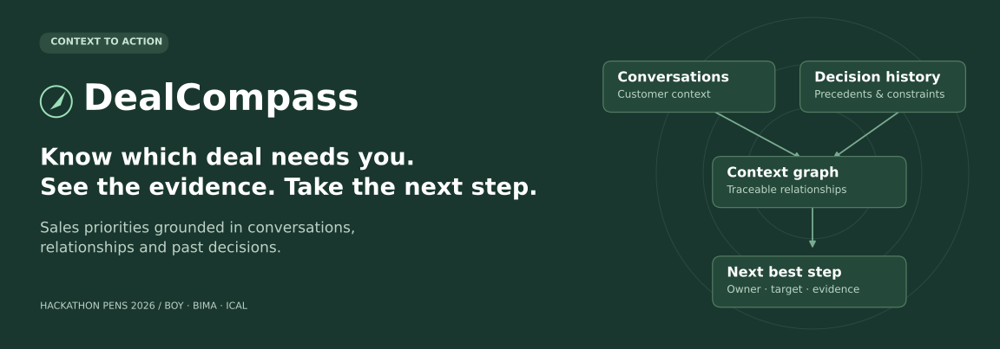
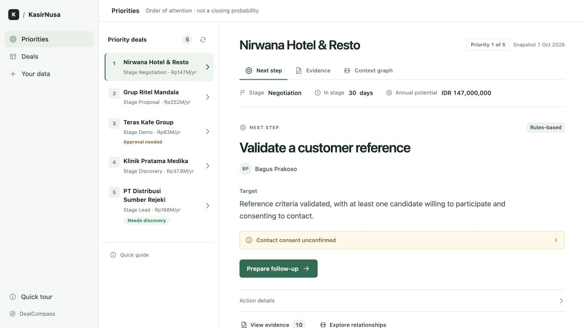
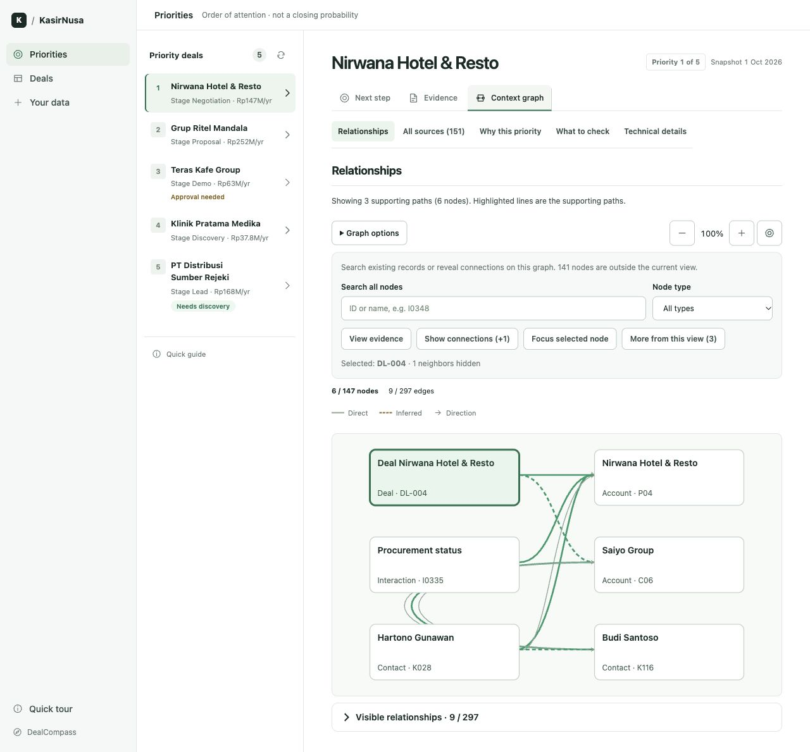
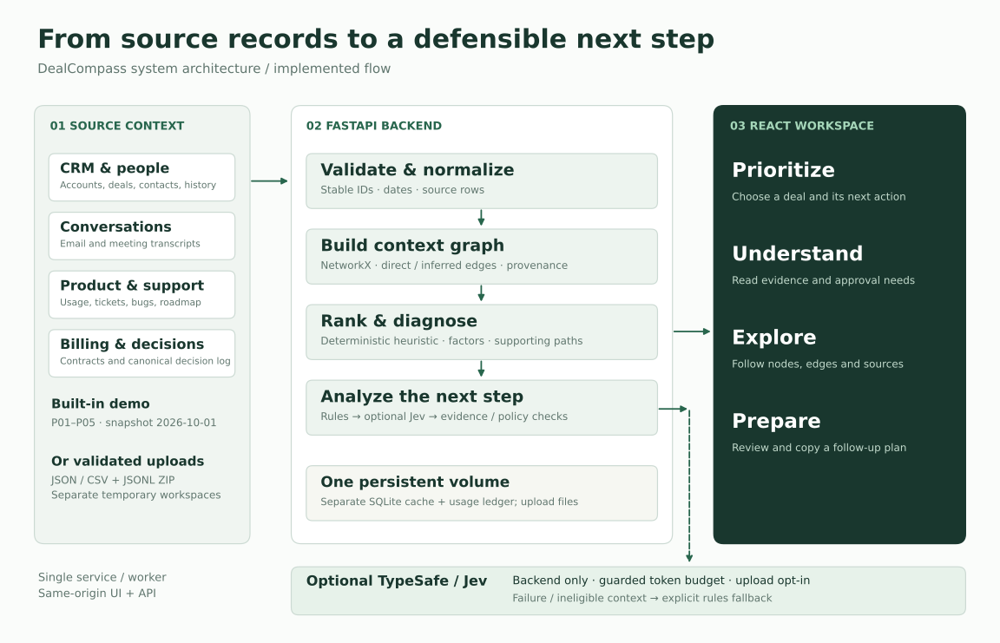
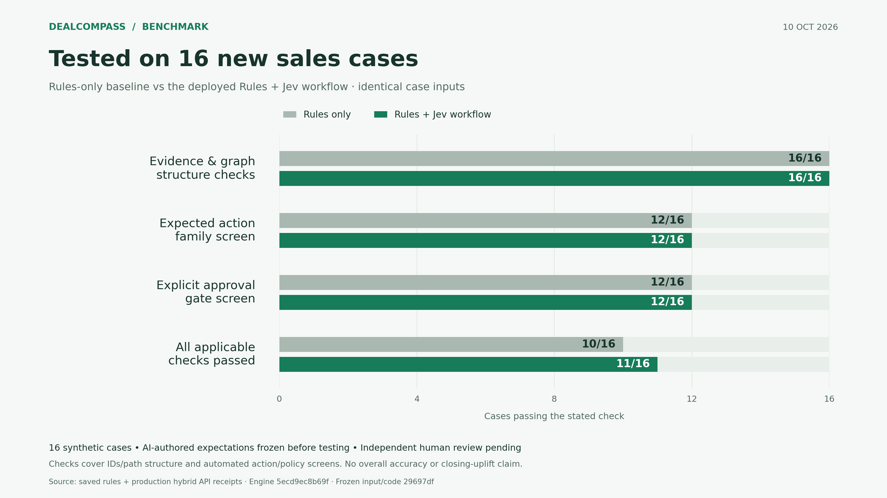

<p align="center">
  
</p>

<p align="center">
  <strong>A sales decision workspace powered by context graphs.</strong><br />
  Prioritize the next conversation, understand the blocker, and trace the recommendation to its source.
</p>

<p align="center">
  <a href="https://github.com/feboyfierlyan/dealcompass/actions/workflows/ci.yml"></a>
  
  
  
</p>

<p align="center">
  <a href="https://dealcompass-production.up.railway.app">Try the demo</a> ·
  <a href="#run-locally">Run locally</a> ·
  <a href="docs/ARCHITECTURE.md">Architecture</a> ·
  <a href="#evaluation">Evaluation</a> ·
  <a href="docs/README.md">Documentation</a>
</p>

## The problem

A CRM tells a salesperson where a deal sits. The reason it is stuck may be buried in an email, a support ticket, a colleague's relationship, or a past exception. Acting on the wrong signal can mean chasing an unready opportunity or promising something that was never approved.

DealCompass brings that context into one desktop workspace. It answers three practical questions:

1. **Which deal deserves attention?** A transparent priority order with visible factors.
2. **What should I do next?** A proposed action, owner, target and prerequisites.
3. **Why this action?** Source records, relationship paths and relevant decision precedents.

Built by **Boy, Bima and Ical** for the Deal Acceleration challenge at Hackathon PENS 2026. The competition is complete; this repository preserves the working prototype, evaluation receipts and engineering handoffs. It is not an enterprise CRM or an independently validated prediction system.

## Product at a glance



*Actual local application, captured in rules mode. Fictional KasirNusa data; values represent annual potential, not realized revenue.*

| Capability | What the user gets |
| --- | --- |
| Deal priorities | All five demo prospects, P01–P05, ranked with a deterministic, explainable heuristic. |
| Next-step analysis | Rules-based analysis, optionally enriched by Jev, with explicit fallback and provenance. |
| Context graph | Clickable nodes and relationships, source evidence, direct/inferred distinctions and supporting paths. |
| Decision history | Precedent comparisons, approval requirements and stated limitations when evidence is missing. |
| Follow-up preparation | A reviewable plan to copy; the app does not send outreach or execute a discount. |
| New-data workspaces | Validated CRM and transcript uploads in a separate temporary workspace. |
| Guided onboarding | An adjacent spotlight tutorial that advances when the user performs the action. |

### A simple sales workflow

**Choose a deal → review the next step → inspect evidence → prepare the follow-up.**

For example, a customer-reference request can connect a prospect, its conversation and a potentially relevant customer. A relationship is a lead to investigate: it does not establish willingness or permission to contact. The recommendation keeps those checks visible.

<details>
<summary><strong>See the context graph in the application</strong></summary>



The initial view focuses on supporting paths. Search and expansion reveal additional existing records; they do not invent new relationships. Solid and dashed edges distinguish source-backed relationships from inferences.

</details>

## Architecture



- **Frontend:** React, TypeScript and Vite; English desktop UI with progressive disclosure.
- **Backend:** FastAPI and Pydantic contracts; a NetworkX context graph with row-level provenance.
- **Decision layer:** deterministic ranking and policy rules, optional TypeSafe/Jev enrichment, validated outputs and explicit fallback.
- **Storage:** source CSV/JSONL, temporary uploaded workspaces, separate SQLite databases for analysis cache and shared provider usage.
- **Deployment:** one Docker service serves the UI and API from the same origin. Live operation uses one worker and a persistent volume.

Ranking remains rules-based. Jev assists eligible next-step analysis; it does not produce a closing probability or replace the approval policy. See [architecture and data flow](docs/ARCHITECTURE.md) for contracts, source groups and request paths.

## Run locally

**Requirements:** Python 3.11+ and Node.js 22.12+ or 24+. CI uses Python 3.12 and Node 24. No API key is required for rules mode.

```bash
git clone https://github.com/feboyfierlyan/dealcompass.git
cd dealcompass
python3 -m venv .venv
source .venv/bin/activate
python -m pip install -r requirements.txt

env -u TYPESAFE_API_KEY DEALCOMPASS_ENGINE_MODE=rules \
  python -m uvicorn backend.main:app --reload --host 127.0.0.1 --port 8000
```

In a second terminal:

```bash
cd dealcompass/frontend
npm ci
npm run dev
```

Open **http://localhost:5173**. API documentation is at **http://127.0.0.1:8000/docs**. Vite proxies `/api` to the local backend. The commands above use macOS/Linux shell syntax; `.env` is not loaded automatically by this server command.

<details>
<summary><strong>Run the built application in one process</strong></summary>

From the repository root, with the Python environment activated and frontend dependencies installed:

```bash
npm --prefix frontend run build
DEALCOMPASS_ENGINE_MODE=rules DEALCOMPASS_PUBLIC_ACCESS=1 \
  python -m backend.deployment
```

Open **http://localhost:8080**. This explicitly enables public demo mode. For a private deployment, use the access configuration in the [Railway guide](docs/DEPLOY_RAILWAY.md).

</details>

### Bring your own data

Open **Your data**, download a JSON example or CSV + transcript kit, replace the fictional records, then **Validate data → Open workspace**.

- Supports CRM tables and text transcripts linked by stable IDs.
- Accepts template-compatible JSON or a ZIP containing CSV, JSONL and a manifest.
- Supports 1–20 open deals, one per account; uploads are bounded and expire after 24 hours.
- Uploading a revision creates a new workspace. The original P01–P05 snapshot stays unchanged.
- Jev export is opt-in for each upload. Rules mode works without sending data to a provider.

The format and KasirNusa policy remain fixed: this is not arbitrary CSV mapping, audio transcription or automatic policy learning. See [formats, limits and privacy](docs/NEW_DATA_AND_BENCHMARK.md).

### Optional Jev integration

Read the [Jev guide](backend/integrations/JEV_LIVE.md) and [deployment guide](docs/DEPLOY_RAILWAY.md) before enabling paid requests. Secrets belong only in backend environment variables. All team calls must share the existing usage ledger; never reset the budget or resume an obsolete local counter after cloud cutover.

The configured team ceiling is **100,000,000 input tokens**. The ledger tracks actual receipts and reservations; missing usage receipts block further spending. The analysis cache is separate from billing history.

## Evaluation

The saved first run tested **16 new synthetic sales cases** through local rules and the deployed Rules + Jev workflow using matching normalized contexts.

| Automated check | Rules | Rules + Jev |
| --- | ---: | ---: |
| Citation IDs and graph/path structure | 16 / 16 | 16 / 16 |
| Expected action-family screen | 12 / 16 | 12 / 16 |
| Explicit approval-gate screen | 12 / 16 | 12 / 16 |
| All applicable checks passed | 10 / 16 | 11 / 16 |



**How to interpret this:** expectations were AI-authored and frozen before execution; independent human review is pending. Valid IDs and graph paths establish structural traceability, not that every claim is semantically supported. These counts are not overall product accuracy, proof of statistically significant superiority, or measured sales uplift.

Failures are retained, including paraphrases excluded from hybrid analysis, a withdrawn request that remains active, and missing explicit approval-gate fields in some cases. The simple CRM baseline also matches the original demo's ranking; improved ranking quality has not been established.

[Raw results and protocol](evaluation/deal_benchmark/README.md) · [Per-case matrix](evaluation/deal_benchmark/figures/benchmark-case-matrix.png) · [Pitch-ready exports](evaluation/deal_benchmark/figures/README.md) · [Broader scorecard](evaluation/results/scorecard_latest.md)

SalesTranscriptQA is a design reference for transcript-grounded evaluation. Its full benchmark has **not** been run against DealCompass; no external benchmark score is claimed.

## Verification

```bash
python -m unittest discover -s tests -v
python scripts/check_handoff.py --all
npm --prefix frontend run build
```

CI runs backend/handoff checks and the frontend build on PRs and `main`. The benchmark evaluator has its own regression checks:

```bash
python -m unittest tests.ical.test_deal_benchmark -v
```

Passing software tests is separate from validating the quality of a sales recommendation. See [project status and known limitations](docs/PROJECT_STATUS.md) for the distinction.

## Repository map

```text
backend/                 API, ingestion, graph, decision engine and Jev adapter
frontend/                Desktop React application
dataset_kasirnusa/       Original fictional challenge data (immutable)
evaluation/              Benchmarks, preserved receipts and review templates
tests/                   Backend and evaluation regression tests
docs/                    Architecture, operating guides and team handoffs
scripts/                 Handoff validation
Dockerfile               Frontend build + Python runtime
```

## Documentation and team

Start with the [documentation index](docs/README.md), [contribution guide](CONTRIBUTING.md), or [restore and maintenance guide](docs/MAINTENANCE.md). Original coordination records remain available as development history.

| Contributor | Primary responsibility |
| --- | --- |
| [Boy](https://github.com/feboyfierlyan) | Frontend, product experience and integration |
| [Bima](https://github.com/bimadji) | Data ingestion, context graph and API |
| [Ical](https://github.com/IXALS) | Decision logic, Jev integration and evaluation |

Built with AI-assisted development, documented handoffs and shared review. All companies and people in the bundled challenge dataset are fictional. The repository does not currently include a software license; public visibility alone does not grant an open-source license. Challenge materials retain their original terms.
